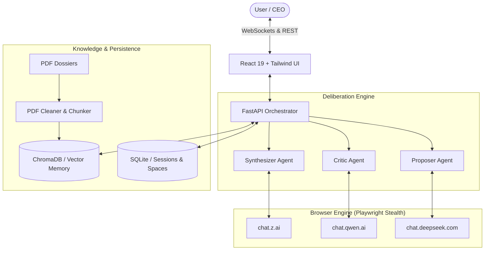

# 🏛️ ThinkTank: Autonomous Multi-Agent Deliberation Platform

[](https://fastapi.tiangolo.com)
[](https://react.dev)
[](https://www.typescriptlang.org)
[](https://playwright.dev)
[](https://tailwindcss.com)
[](LICENSE)

**ThinkTank** is an autonomous multi-agent reasoning and deliberation platform. It orchestrates frontier AI models (such as **DeepSeek**, **Qwen**, and **GLM / Zhipu AI**) simultaneously to debate, critique, collaborate, and synthesize solutions for complex problems—**without requiring API keys or incurring token fees**.

By driving persistent, stealth browser sessions and enforcing strict JSON communication protocols, ThinkTank turns consumer-facing AI chat portals into a synchronized, structured council of AI advisors.

---

## ⚡ Key Highlights

* **⚔️ 4 Orchestrated Workflows:**
  * **Debate Mode:** Alternating rounds between a visionary *Proposer* and a relentless *Critic* (hunting for logical fallacies and edge cases), auto-converging when confidence is high and severity drops, concluded by a *Synthesizer*.
  * **Collaborate Mode:** Parallel task decomposition across multiple models merged into a unified master strategy.
  * **Refine Mode:** Sequential pipeline passing drafts through *Drafter* ➔ *Editor* ➔ *Polisher*.
  * **Coach Mode:** Socratic probing and mentoring utilizing structured psychological and philosophical frameworks.
* **👔 Co-Pilot Mode & CEO Directives:** Real-time human-in-the-loop controls. Pause between turns to review arguments, inject overrides, or redirect agent reasoning on the fly.
* **📚 Knowledge Vault & Spaces (RAG):** Upload PDF literature and domain dossiers. Text is automatically cleaned, chunked, and embedded into **ChromaDB**. Agents are prompted to cite claims directly using format: `[Book Title, Page X]`.
* **🧠 Corporate Memory:** Automatically saves past winning strategies into vector memory, allowing the council to recall historical context for future deliberations.
* **🛡️ Self-Healing JSON Engine:** Output is enclosed in `<THINK_JSON>` boundaries and validated with Pydantic. If a model hallucinates malformed syntax, an automated repair loop triggers an immediate correction turn.
* **🕵️ Native Reasoning Capture:** Scrapes native thinking/reasoning traces directly from the browser DOM (e.g., DeepSeek R1 reasoning blocks) and surfaces them in the UI.

---

## 🏗️ Architecture



---

## 📁 Project Structure

```
ThinkTank/
├── backend/
│   ├── automation.py       # Playwright browser engine & stealth automation
│   ├── database.py         # SQLite models & session/space persistence
│   ├── json_utils.py       # Bulletproof JSON repair & tag extraction
│   ├── main.py             # FastAPI entrypoint, REST API & WebSocket server
│   ├── memory.py           # ChromaDB vector store (Corporate Memory & Vault)
│   ├── models.py           # Pydantic schemas for agent thoughts & critiques
│   ├── orchestrator.py     # Deliberation workflows (Debate, Refine, etc.)
│   ├── pdf_cleaner.py      # Noise removal & semantic chunking for PDFs
│   ├── prompts.py          # Structured system prompts and role schemas
│   ├── requirements.txt    # Python dependencies
│   └── run.py              # Windows ProactorEventLoop-safe launcher
├── frontend/
│   ├── src/
│   │   ├── components/     # UI components (History, Library, Modals, etc.)
│   │   ├── hooks/          # useWebSocket and lifecycle hooks
│   │   ├── App.tsx         # Central mission-control interface
│   │   └── main.tsx        # React entrypoint
│   ├── package.json        # Node dependencies & scripts
│   └── vite.config.ts      # Vite configuration & dev proxy
├── .gitignore              # Ignores browser data, caches, DBs, and venvs
├── LICENSE                 # MIT License
└── README.md
```

---

## 🚀 Quickstart Guide

### Prerequisites

* **Python 3.10+** (Python 3.11 or 3.12 recommended)
* **Node.js 18+** & **npm**
* Google Chrome installed on your machine

---

### 1. Backend Setup

1. Open a terminal in the project directory:
   ```bash
   cd backend
   ```
2. Create and activate a Python virtual environment:
   ```bash
   # Windows (PowerShell)
   python -m venv venv
   .\venv\Scripts\Activate.ps1

   # macOS / Linux
   python3 -m venv venv
   source venv/bin/activate
   ```
3. Install backend dependencies:
   ```bash
   pip install -r requirements.txt
   ```
4. Install Playwright browser binaries:
   ```bash
   playwright install chromium
   ```
5. Launch the backend server:
   ```bash
   # Use run.py (handles Windows Proactor loop for Playwright)
   python run.py
   ```
   *The backend will start at `http://127.0.0.1:8001`.*

---

### 2. Frontend Setup

1. In a new terminal, navigate to the frontend directory:
   ```bash
   cd frontend
   ```
2. Install dependencies:
   ```bash
   npm install
   ```
3. Start the Vite development server:
   ```bash
   npm run dev
   ```
4. Open your browser and navigate to:
   ```
   http://localhost:5173
   ```

---

## 🖥️ Operating Instructions

1. **Connect Agent Fleet:**
   * In the top-left panel, click **Setup Agents**.
   * A persistent Chromium browser window will launch with tabs for DeepSeek, Qwen, and GLM.
   * If prompted, sign in manually to each platform in that browser window (login cookies are securely preserved locally in your `browser_data` folder).
   * Once logged in, click **Confirm Login** in the ThinkTank UI.
2. **Select Execution Mode:** Choose between **Debate**, **Collaborate**, **Refine**, or **Coach**.
3. **Optional Context (Spaces):** Create a Knowledge Space and upload reference PDFs to anchor the council's arguments in your domain literature.
4. **Co-Pilot Mode:** Enable the toggle if you want the deliberation to pause after every turn for your executive review.
5. **Run:** Enter your problem statement or prompt, and watch the agents autonomously deliberate, challenge fallacies, and synthesize an executive roadmap.

---

## 🛠️ Tech Stack

| Component | Technology |
| :--- | :--- |
| **Backend Framework** | [FastAPI](https://fastapi.tiangolo.com/) + [Uvicorn](https://www.uvicorn.org/) |
| **Browser Automation** | [Playwright](https://playwright.dev/) + [playwright-stealth](https://github.com/AtuboDad/playwright_stealth) |
| **Vector Database** | [ChromaDB](https://www.trychroma.com/) + [Sentence Transformers](https://sbert.net/) |
| **Relational Database** | [SQLite](https://www.sqlite.org/) via [SQLAlchemy](https://www.sqlalchemy.org/) |
| **Document Processing** | [PyMuPDF (fitz)](https://pymupdf.readthedocs.io/) |
| **Frontend Framework** | [React 19](https://react.dev/) + [TypeScript](https://www.typescriptlang.org/) + [Vite](https://vite.dev/) |
| **Styling & Components**| [Tailwind CSS](https://tailwindcss.com/) + [Radix UI](https://www.radix-ui.com/) + [Lucide Icons](https://lucide.dev/) |

---

## ⚖️ Disclaimer

This project is created for research and educational purposes to explore multi-agent deliberation patterns and human-in-the-loop orchestration. Ensure you review and adhere to the respective terms of service for any external web platforms accessed via automated tooling.

---

## 📄 License

This project is licensed under the [MIT License](LICENSE).
